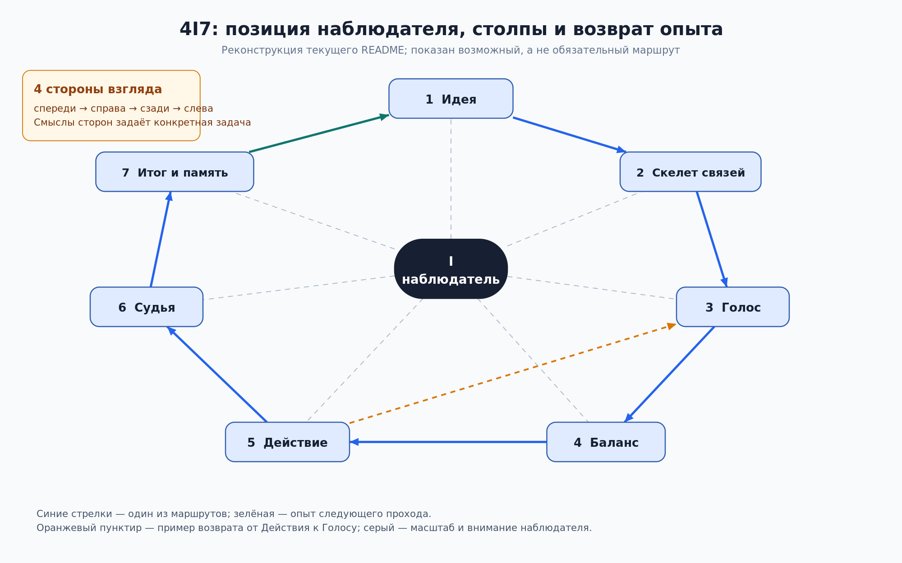
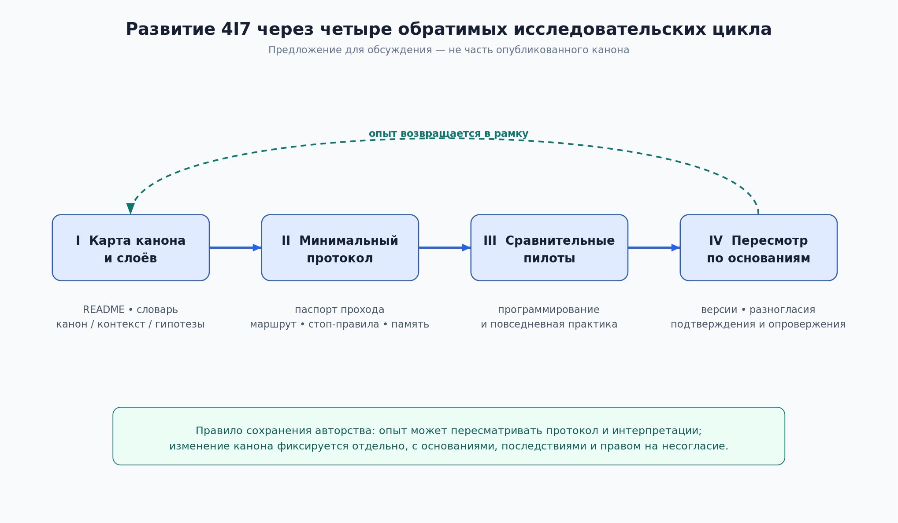

# 4I7_psys: внутренняя реконструкция и программа развития

**Дата исследования:** 19 ноября 2026 года  
**Проверенная версия:** ветка `main`, коммит `43069c3114a20f43a0f6dc210e725b44d96690a3`  
**Характер работы:** концептуальное и сравнительное исследование; эмпирическая проверка эффективности 4I7 не проводилась  
**Главный объект:** не только текст `README.md`, но и способ применить его собственные принципы к развитию самой системы

## Резюме

Центральный вывод исследования состоит в том, что 4I7 уже содержит целостную, хотя ещё не полностью операционализированную архитектуру понимания. Её единицей является не отдельный этап и не формальный объект, а **переход между намерением, структурой, выражением, мерой, действием, проверкой и памятью**, совершаемый из явно признанной позиции наблюдателя. Поэтому систему нельзя правильно развить простым превращением `README.md` в последовательность команд или в программный конвейер: при таком упрощении исчезло бы её главное свойство — возможность возвращаться к ранее принятой рамке и менять само понимание задачи. Спираль здесь отличается от круга не количеством повторений, а качеством возврата: новый проход начинается с преобразованного опытом замысла, другой границы системы, иного распределения внимания или более точного критерия проверки. Такое прочтение непосредственно опирается на определения синергии, наблюдателя, столпов и спирали в исходном тексте, но формулировка «рефлексивная архитектура внимания» является моей интерпретацией, а не термином репозитория ([4I7 README](https://github.com/i4w7w4a/4i7_psys/blob/43069c3114a20f43a0f6dc210e725b44d96690a3/README.md)).

Главный пробел также не сводится к отсутствию кода. В опубликованном тексте ещё не заданы четыре вещи, необходимые для воспроизводимого исследования: способ выбирать и объявлять смыслы четырёх сторон до начала работы; формат наблюдений и результатов, передаваемых между столпами; критерии выбора маршрута и временного завершения прохода; правила, позволяющие отличить новое понимание от более уверенного повторения прежнего мнения. Дополнительный авторский контекст диалога вводит паузу между наблюдением и действием, оракула, который собирает основания, но может ошибаться и не подавляет самостоятельность частей, а также ориентиры открытости 47 и мастерства 74. Эти положения важны для текущей работы, однако в проверенном `README.md` их нет, поэтому отчёт относит их не к опубликованному канону, а к отдельному операционному слою. Предлагаемое развитие потому строится через обратимые исследовательские циклы: сначала различить канон, контекст, интерпретации и гипотезы; затем испытать минимальный протокол прохода; после этого сравнить его с обычной практикой на реальных задачах и лишь по полученным основаниям пересматривать рамку.

| Вывод | Статус | Практическое следствие |
|---|---|---|
| 4I7 — не обязательная последовательность семи шагов, а сеть функций с возвратами | Интерпретация, прямо согласованная с примерами возвратов в `README` | В спецификации нужны маршруты и условия перехода, а не один жёсткий сценарий |
| Наблюдатель входит в систему описания, а не стоит над ней в позиции полной нейтральности | Интерпретация `I` в сопоставлении с критической системной практикой | Для каждого прохода следует фиксировать границы, масштаб, намерение и возможные слепые зоны |
| Семь столпов уже заданы функционально, но не имеют единого формата входов и выходов | Фактическое состояние текста и вытекающий из него пробел | Минимальный «паспорт прохода» важнее преждевременного выбора технологии реализации |
| Синергия не должна измеряться количеством завершённых столпов или объёмом заметок | Предложение по проверяемости | Нужны контраст с исходной практикой, след влияния проверки на решение и признаки переноса опыта |
| Оракул и пауза принадлежат текущему авторскому контексту, но не опубликованному `README` | Разграничение корпуса | Их следует вводить как отдельную версию расширения с описанием полномочий и ограничений |
| Эффективность 4I7 пока не подтверждена и не опровергнута | Граница исследования | Первые пилоты обязаны допускать нулевой и отрицательный результат |

## 1. Корпус, позиция и метод исследования

### 1.1 Что фактически находится в репозитории

На момент проверки дерево ветки `main` содержит один файл `README.md` размером 9164 байта, а история, полученная для этой ветки, показывает один коммит с сообщением «Describe the foundations of 4I7», датированный 13 ноября 2026 года. Следовательно, все утверждения о составе опубликованной системы должны быть ограничены этим текстом: в репозитории нет отдельной спецификации, исходного кода, тестов, журнала решений, лицензионного файла или прикладных примеров, оформленных как самостоятельные артефакты. Это не означает, что таких материалов не существует вне репозитория; означает лишь, что они не были доступны как часть проверенного дерева и не могут молча присоединяться к анализу. Ссылка на конкретный коммит используется для того, чтобы дальнейшие изменения `main` не подменяли предмет исследования и чтобы каждое различие между текущим выводом и будущей редакцией можно было проверить ([дерево коммита](https://github.com/i4w7w4a/4i7_psys/tree/43069c3114a20f43a0f6dc210e725b44d96690a3), [история коммита](https://github.com/i4w7w4a/4i7_psys/commit/43069c3114a20f43a0f6dc210e725b44d96690a3)).

Технический доступ также требует точного описания, поскольку он ограничивает воспроизводимость процедуры чтения. В вычислительной среде команда `gh` исходно отсутствовала в `PATH`; официальный GitHub CLI версии 2.105.0 был загружен и запущен локально, однако `gh repo view` и `gh repo clone` остановились на требовании авторизации даже после того, как репозиторий стал публичным. Две попытки обычного чтения через `git clone` завершились TLS-ошибкой. Поэтому содержимое, дерево и история были получены через доступный авторизованный GitHub-канал чтения, а не через успешно завершённую команду CLI. Никаких операций записи в репозиторий не выполнялось. Это ограничение не меняет содержание полученного `README.md`, но исключает утверждение, будто исследование полностью проведено именно через `gh`; отдельный анализ скрытых веток, неиндексируемых материалов или локальных файлов автора также не производился.

| Наблюдаемый элемент | Проверенное состояние | Что можно заключить | Что нельзя заключить |
|---|---|---|---|
| `README.md` | Единственный файл в корне проверенного дерева ([4I7](https://github.com/i4w7w4a/4i7_psys/tree/43069c3114a20f43a0f6dc210e725b44d96690a3)) | Концептуальное ядро опубликовано в компактной форме | Что проект задуман исключительно как документация |
| История ветки | Один видимый коммит от 13 ноября 2026 года ([коммит](https://github.com/i4w7w4a/4i7_psys/commit/43069c3114a20f43a0f6dc210e725b44d96690a3)) | Нет опубликованной цепочки редакционных решений для сравнения версий | Что до этого не было черновиков или устной разработки |
| Программные артефакты | Не представлены в дереве | Говорить о реализации преждевременно | Что реализация не нужна или невозможна |
| Лицензия | Файл лицензии отсутствует в проверенном дереве | Публичная видимость сама по себе не задаёт широкие права повторного использования ([GitHub Docs](https://docs.github.com/articles/licensing-a-repository)) | Какую лицензию автор должен выбрать без обсуждения целей проекта |

### 1.2 Как отделены канон, интерпретация и расширение

Слово «канон» используется в отчёте как исследовательское обозначение, а не как термин, заявленный в самом `README.md`. В опубликованный канон включены только положения, которые прямо присутствуют в проверенном тексте: исходное понимание синергии, зависимость понимания от ракурса, рекурсивная связь замысла, действия и наблюдения, четыре стороны, позиция `I`, семь столпов, пример спирали, два практических примера и три группы открытых вопросов. Авторский операционный контекст диалога образует второй слой, поскольку он уточняет движение через паузу, ограниченность оракула и автономию частей, но не зафиксирован в репозитории. Третий слой составляют мои реконструкции, например описание системы как архитектуры внимания. Четвёртый содержит гипотезы, которые можно проверить практикой, а пятый — предложения по документам, протоколам и экспериментам. Такое деление предотвращает тихую подмену авторства: читатель всегда может увидеть, где анализируется существующий смысл, а где создаётся новый.

Вход в рамки 4I7 в этом исследовании означает методическую дисциплину, а не заявление о человеческом осознании или субъективном переживании. Я сначала рассматриваю целое через связи его частей, затем проверяю, как каждая часть меняет представление о целом, после чего возвращаю полученный результат в следующий проход. Внешние теории используются не для назначения «настоящих предков» системы и не для оценки её новизны, а как различные ракурсы, способные обнаружить скрытые допущения. Точный поиск публичных следов формулировки 4I7 не дал оснований строить такую родословную, однако отсутствие найденных совпадений не доказывает абсолютную оригинальность. Поэтому сравнительные утверждения ниже всегда имеют ограниченную форму: «структурно сопоставимо», «помогает уточнить», «предостерегает от», но не «происходит из» и не «доказано внешней традицией».

| Метка | Слой содержания | Правило использования |
|---|---|---|
| **К** | Положения проверенного `README.md` | Можно цитировать как опубликованную основу с постоянной ссылкой на коммит |
| **АК** | Авторский контекст текущего диалога | Можно применять как рабочую установку, явно отделяя от содержимого репозитория |
| **И** | Интерпретация исследователя | Должна показывать, из каких элементов текста или сопоставления она следует |
| **Г** | Проверяемая гипотеза | Обязана иметь возможный опровергающий результат и ограничения |
| **П** | Предложение по развитию | Не приобретает статус канона без отдельного авторского решения |
| **ОГ** | Ограничение или неизвестное | Не заполняется воображаемыми фактами, а превращается в вопрос следующего прохода |

## 2. Внутренняя архитектура 4I7

### 2.1 Синергия, наблюдатель и рекурсивное целое

Исходный текст задаёт синергию через взаимное усиление работы частей, а не через безусловный числовой выигрыш и не через универсальную формулу «целое больше суммы». Пример с проверкой особенно показателен: её результат должен менять одновременно текущее действие и понимание задачи. Из этого следует более сильная реконструкция: часть становится компонентом 4I7 не тогда, когда она формально присутствует в списке, а когда её результат способен повлиять на другую часть и вернуться изменённым в общий ход работы. `I` удерживает намерение, масштаб и внимание, поэтому не является просто восьмым столпом или пассивной точкой зрения. В программной системе эта функция может быть оркестратором, однако текст не утверждает, что оркестратор обязан быть единственным наблюдателем или безошибочным центром управления. Именно связь наблюдателя с переходами, а не наличие центрального узла сама по себе, образует здесь целое ([4I7 README](https://github.com/i4w7w4a/4i7_psys/blob/43069c3114a20f43a0f6dc210e725b44d96690a3/README.md)).

Рекурсия проявляется на двух уровнях. На уровне практической задачи замысел направляет действие, действие приносит наблюдения, а наблюдения уточняют замысел; на уровне отдельной части тот же ход повторяется в меньшем масштабе, после чего результат может вернуться на уровень целого. Поэтому применение 4I7 к самой 4I7 не является внешним трюком: оно прямо разрешено исходной логикой. Но рекурсия создаёт и внутреннее напряжение. Если наблюдатель выбирает масштаб и внимание, то выбор рамки сам должен становиться доступным наблюдению; иначе `I` получает неограниченную власть над тем, что будет считаться частью целого. Дополнительный авторский контекст снимает часть этого риска через оракула, который собирает основания, может ошибаться и не подавляет самостоятельность частей. В опубликованном тексте такой механизм ещё не описан, поэтому ограничение власти наблюдателя следует считать необходимым направлением развития, а не уже завершённым свойством системы.

| Инвариант ядра | Как он проявляется в тексте | Что будет считаться его нарушением при разработке |
|---|---|---|
| Целое понимается через взаимодействия | Свойства целого зависят от влияния частей друг на друга | Семь независимых модулей, которые не меняют решения друг друга |
| Наблюдение зависит от позиции | Другой ракурс обнаруживает новые связи и ограничения | Выдача одной карты системы за полную и нейтральную реальность |
| Опыт возвращается в замысел | Наблюдения дают основания уточнить намерение | Цикл, где после проверки меняется только исполнение, а исходные допущения остаются недоступными |
| Масштаб может меняться | Ход повторяется в целом и внутри части | Жёсткое разделение «стратегии» и «операций» без возврата локального открытия наверх |
| Разногласие информативно | Расхождение взглядов побуждает проверить условия, цели и предположения | Подавление различий ради единого голоса или быстрого консенсуса |

### 2.2 Семь столпов как функции, а не стадии

Каждый столп в исходной таблице задан функцией и вопросом, но не задан как изолированный программный объект. Это позволяет применять систему к разным областям, не требуя, чтобы «Идея» или «Голос» всегда имели одинаковую материальную форму. В исследовании программного проекта результатом Идеи может быть описание желаемого изменения и неприкосновенных условий; в музыкальной практике — ближайшая художественная цель. Однако переносимость имеет цену: без минимального результата каждого столпа два участника могут использовать одинаковые названия и при этом выполнять несовместимые операции. Поэтому предлагаемая формализация должна определять не обязательную процедуру, а **контракт наблюдения**: что столп старается обнаружить, какой след оставляет и как другой столп может использовать или оспорить этот след. Такой контракт расширяет исходную таблицу, не меняя её функций.

В таблице ниже исходные функции сопоставлены с предлагаемыми минимальными выходами. Слова «артефакт» и «запись» не следует понимать бюрократически: для короткой задачи артефактом может быть одна фраза, для исследования — связанный набор доказательств, а для программной реализации — структурированный объект. Важно лишь, чтобы следующий столп получал не только вывод, но и основание для проверки. Например, Судья должен видеть ожидание, сформулированное до действия, а Итог и память — различие между наблюдением, интерпретацией и решением. Если это различие исчезает, повторный проход легко превращается в ретроспективное оправдание уже сделанного. Поэтому семь столпов лучше развивать как взаимные ограничения: Идея ограничивает произвольное действие, Голос — скрытое намерение, Баланс — чрезмерную меру, Судья — самоподтверждение, а память — повторение без учёта прошлого опыта.

| Столп | Исходная работа и вопрос | Предлагаемый минимальный выход **(П)** | Нерешённый вопрос для развития |
|---|---|---|---|
| **1. Идея** | Обнаружить намерение: что хотим изменить и зачем? | Желаемое изменение, затронутые стороны, исходные допущения, критерий значимости | Как отличить подлинное намерение от удобной ретроспективной формулировки? |
| **2. Скелет связей** | Увидеть части, целое и зависимости | Карта границ, частей, связей со средой и критических неизвестных | Какая форма карты сохраняет динамику и не претендует на полноту? |
| **3. Голос** | Услышать позиции и сделать замысел обсуждаемым | Версии понимания, несогласия, непереведённые термины, согласованная формулировка | Кто получает право голоса и как сохраняется меньшинство без блокировки действия? |
| **4. Баланс** | Соотнести желаемое с условиями и последствиями | Выбранная мера, ограничения, цена, обратимость, критерий остановки | Как сравнивать несоизмеримые ценности, не скрывая их за одним баллом? |
| **5. Действие** | Воплотить замысел и увидеть практический результат | Описание вмешательства, наблюдения, отклонения, незапланированные эффекты | Как сохранить наблюдение независимым от ожидаемого успеха? |
| **6. Судья** | Сверить результат с ожиданиями и найти основания | Матрица «ожидание — наблюдение — расхождение — вывод», альтернативные объяснения | Какие признаки опровергают вывод и кто может оспорить судью? |
| **7. Итог и память** | Усвоить опыт для следующего шага | Изменение модели, решение, происхождение вывода, дата пересмотра, открытый вопрос | Что стоит забыть, как версионировать смысл и предотвратить закрепление ошибки? |

### 2.3 Четыре стороны и условие настоящей спирали

В опубликованном примере стороны образуют порядок поворота: «спереди», «справа», «сзади», «слева». Первые четыре столпа получают их последовательно, затем порядок повторяется для Действия, Судьи и Итога, причём начальную сторону и направление поворота разрешено выбирать. Если обозначить порядковый номер столпа в этом конкретном маршруте через `k`, то его позицию можно компактно записать как `1 + ((k − 1) mod 4)`, где числа соответствуют перечисленным сторонам. Эта запись лишь формализует пример и не должна становиться универсальным законом 4I7: текст прямо оставляет смыслы сторон открытыми, допускает остановку, возврат к прежнему столпу и другой маршрут. Поэтому важнейшее требование к четырём сторонам — не закрепить навсегда четыре значения, а сделать обязательным их объявление до прохода, чтобы наблюдатель знал, какие различия внимания он намерен проверить ([4I7 README](https://github.com/i4w7w4a/4i7_psys/blob/43069c3114a20f43a0f6dc210e725b44d96690a3/README.md)).

Сама по себе такая последовательность описывает цикл, но ещё не доказывает наличие спирали развития. Спираль возникает, когда память меняет исходную точку следующего прохода, а сопоставление проходов выявляет не только совпадения, но и изменённые допущения, границы и отношения. В предлагаемой интерпретационной записи это можно выразить как `M(n+1) = T(M(n), O(n), D(n))`: следующая модель `M` получается из прежней модели, наблюдений `O` и зафиксированных разногласий `D` через преобразование `T`. Если `T` всегда возвращает исходную модель без изменений, повторение остаётся кругом; если меняется лишь уверенность участников, но не проверяемое содержание модели, это также недостаточно для спирали понимания. Формула не является математической теорией 4I7 и не имеет измерительной силы сама по себе; её назначение — задать вопрос о наблюдаемом преобразовании после каждого прохода.

| Элемент спирали | Что уже задано | Что требуется для воспроизводимого исследования **(П)** |
|---|---|---|
| Поворот взгляда | Порядок четырёх сторон и возможность выбрать начало и направление | Заранее записать смыслы сторон и причину выбора именно этих ракурсов |
| Переход между столпами | Наблюдение переносится в следующий вопрос | Указать, какой результат предыдущего столпа используется следующим |
| Возврат | Можно вернуться, например, от Действия к Голосу | Зафиксировать триггер возврата и изменённое решение, а не только маршрут |
| Задержка | Можно остаться на одном столпе ради недостающего понимания | Задать признак незавершённости и предел затрат, чтобы пауза не стала бесконечной |
| Новый проход | Усвоенный опыт становится исходной точкой | Сравнить модель до и после, сохранив разногласия и остаточную неопределённость |

*Рисунок 1. Схема показывает один допустимый маршрут и возвраты, а не обязательный алгоритм. Построена по проверенному `README.md`; визуальное размещение узлов не добавляет нового смысла четырём сторонам.*

## 3. Применение 4I7 к самой системе

### 3.1 Диагностика через семь столпов

Если предметом прохода становится сама 4I7, то её открытые вопросы перестают быть внешним списком пожеланий и превращаются в наблюдаемые функции системы. Идея спрашивает, какое изменение должна произвести сама рамка; Скелет — как связаны её компоненты; Голос — как разные участники и исследователи могут говорить о ней, не насилуя авторский смысл; Баланс — какая формализация достаточна без чрезмерной бюрократии; Действие — какой реальный проход можно выполнить; Судья — по каким признакам станет видно улучшение; Итог — как следующая редакция сохранит и основания, и разногласия. Такой самопроход показывает сильную сторону системы: один и тот же язык позволяет обсуждать философию, практику и её собственное развитие. Но он же обнаруживает риск самоподтверждения, поскольку рамка может заранее объявить любой результат проявлением одного из своих столпов и тем самым стать неопровержимой.

Поэтому диагностика ниже не содержит общей оценки зрелости и не выставляет баллов. Наличие текста о проверке не означает наличия проверки, а наличие раздела о памяти не доказывает, что опыт уже способен менять будущие решения. Для каждого столпа указаны наблюдаемая опора и недостающий след, который можно создать без изменения философского ядра. Отрицательный результат здесь особенно ценен: если участники после использования 4I7 не различают больше оснований, не принимают более обратимых решений и не переносят опыт лучше, чем при их обычной работе, соответствующая гипотеза о пользе протокола должна быть отклонена или ограничена конкретным контекстом. Система, разрешающая пересмотр целого, должна разрешать и честный вывод о неэффективности собственной текущей формы.

| Столп самопрохода | Наблюдаемая опора | Недостающий след и ближайший исследовательский шаг **(П)** |
|---|---|---|
| Идея | Заявлена основа для синергических систем в разных областях | Сформулировать, какие изменения в мышлении и действии должны отличать применение 4I7 от красивой переупаковки работы |
| Скелет связей | Заданы `4`, `I`, `7`, спираль, рекурсия и возвраты | Построить явную карту обязательных отношений и отделить её от возможных маршрутов |
| Голос | Текст ясно задаёт вопросы и приводит примеры из программирования и музыки | Добавить протокол авторских уточнений, альтернативных прочтений и сохранённого несогласия |
| Баланс | Требуется соотносить желаемое с условиями и последствиями | Определить допустимую цену прохода, минимум записей и условия, когда лучше действовать без полного обхода |
| Действие | Описаны два гипотетических применения | Провести документированные проходы на реальных задачах с исходной фиксацией ожиданий |
| Судья | Проверка должна сверять результат с ожиданиями | Заранее задать контраст, критерии, возможность опровержения и независимый разбор оснований |
| Итог и память | Опыт должен менять следующий замысел | Создать версию памяти с происхождением выводов, датой пересмотра и ссылками на изменённые решения |

### 3.2 Четыре стороны как проверяемый инструмент исследования

Для исследования самой системы предлагается временная, не каноническая интерпретация сторон: **спереди — утверждение, справа — основание, сзади — отношение, слева — пересмотр**. «Утверждение» спрашивает, что именно говорится о столпе или целом; «основание» — из какого текста, наблюдения или расчёта это следует; «отношение» — кого затрагивает вывод, какие альтернативные позиции и связи он затемняет; «пересмотр» — какое наблюдение могло бы изменить вывод и когда он должен быть повторно проверен. Эти четыре ракурса выбраны потому, что отвечают главным пробелам текущего корпуса: различению фактов и смыслов, доказательственности, множественности голосов и обратимости. Их можно применить к каждому столпу, не превращая столпы в последовательные стадии. Например, для Судьи четыре стороны означают: каков вывод, на чём он основан, кто его оспаривает и при каком условии он будет отменён.

Другой набор мог бы называться «цель — устройство — опыт — последствие» и лучше подходить для проектирования конкретного программного продукта. Сравнение наборов само должно стать экспериментом, потому что универсальность сторон нельзя установить одним красивым рассуждением. При смене набора сохраняется не содержание сторон, а процедурный инвариант: до начала прохода участники объявляют значения, после прохода оценивают, какие новые наблюдения появились, а затем решают, стоит ли использовать набор повторно. Пауза из авторского контекста здесь получает практическое место между сторонами: она позволяет заметить, что следующий поворот не меняет решение и потому избыточен. Если же пауза используется как обязательная задержка независимо от задачи, она может стать ритуалом; её польза должна оцениваться по качеству уточнённого намерения и предотвращённым необратимым шагам.

| Сторона в экспериментальном наборе **(П)** | Универсальный вопрос | Минимальный след | Какой сбой предотвращает |
|---|---|---|---|
| Спереди — утверждение | Что именно утверждается и в каком масштабе? | Короткая формулировка со статусом `К / АК / И / Г / П` | Смешение наблюдения, интерпретации и решения |
| Справа — основание | Почему это можно считать обоснованным? | Ссылка, наблюдение, расчёт или явно названное допущение | Уверенный вывод без проверяемой опоры |
| Сзади — отношение | Кто и что затронуто, какие связи и позиции исключены? | Затронутые стороны, альтернативный взгляд, несогласие | Нейтральный на вид центр и невидимые последствия |
| Слева — пересмотр | Что изменит вывод и когда его следует проверить снова? | Опровергающее наблюдение, срок или триггер пересмотра | Превращение временной модели в догму |

## 4. Расширение горизонта через внешние сопоставления

### 4.1 Герменевтический круг и наблюдающая система

Герменевтический круг помогает уточнить, почему движение между частью и целым в 4I7 не обязано вести к окончательному фундаменту. В классической формулировке целое необходимо для понимания частей, а части — для понимания целого; современные описания дополнительно подчёркивают пересмотр тех предпосылок, через которые предмет вообще становится видимым. Это близко исходному правилу, согласно которому работа с частью может изменить представление о целом и вернуться на его уровень. Но внешнее сопоставление добавляет предостережение: понимание может становиться богаче без того, чтобы приближаться к единственной завершённой интерпретации. Поэтому качество прохода 4I7 не обязано измеряться сходимостью всех взглядов. Иногда более глубокое понимание проявляется в том, что участники точнее видят, почему их выводы расходятся и какие предпосылки порождают различие ([Stanford Encyclopedia](https://plato.stanford.edu/entries/hermeneutics/)).

Кибернетика второго порядка сдвигает внимание с наблюдаемых систем на наблюдающие и тем самым усиливает смысл `I`. Бернард Скотт связывает это различение с работой фон Фёрстера: наблюдатель уже не может считаться просто внешней камерой, а его собственные описания становятся предметом исследования. Для 4I7 это означает, что позиция наблюдателя должна включаться в память прохода вместе с результатом; иначе последующий участник получит вывод без знания масштаба, цели и ракурса, при которых он возник. Вместе с тем `I` не следует абсолютизировать. Если оркестратор определяет единственную допустимую рамку, система воспроизводит внешнюю позицию контроля под новым именем. Сопоставление поддерживает распределённую модель, в которой наблюдатель собирает и сопоставляет основания, но его собственная карта доступна критике со стороны частей ([Scott, Kybernetes](https://doi.org/10.1108/03684920410556007)).

| Подход | Структурное сходство с 4I7 | Важное различие или предупреждение | Что можно исследовать дальше **(П)** |
|---|---|---|---|
| Герменевтический круг | Часть и целое взаимно уточняются; предпосылки пересматриваются | Богатство понимания не равно окончательному единству интерпретаций | Сохранять историю изменения предпосылок, а не только итоговый консенсус |
| Кибернетика второго порядка | Наблюдатель включается в описание системы | Центральный наблюдатель тоже ограничен и подлежит наблюдению | Записывать позицию `I`, границы видимости и способ её оспаривания |
| Авторская специфика 4I7 | Семь функций, четыре выбираемые стороны и практический переход к действию | Эти элементы не заменяются общей идеей рефлексии | Проверять, даёт ли именно их сочетание результат сверх свободной ретроспективы |

### 4.2 Двойной контур обучения и рефлексивная практика

Различие одинарного и двойного контура обучения позволяет точнее отделить исправление действия от пересмотра управляющих переменных. В первом случае участник спрашивает, как лучше достичь прежней цели; во втором — верны ли сама цель, нормы и допущения, которые направляют действие. Для 4I7 это различие соответствует границе между обычной корректировкой и спиралью понимания: если Судья меняет только технику Действия, проход может остаться в пределах одинарного контура; если результат меняет Идею, Скелет или саму позицию наблюдателя, возникает возможность более глубокого пересмотра. Однако двойной контур не следует превращать в обязательную ступень каждого малого действия. Иногда цель ясна, а требуется лишь исправить исполнение; постоянный пересмотр основ сделал бы практику нестабильной и дорогой ([Argyris, HBR](https://hbr.org/1977/09/double-loop-learning-in-organizations), [University of Michigan](http://core2.miserver.it.umich.edu/s/ire/item/4183)).

Рефлексивная практика Шёна добавляет временное различие между размышлением внутри действия и размышлением о нём после завершения. Обзор исследований рефлексии подчёркивает не только эти режимы, но и разные глубины — от технической проверки до критического анализа последствий и собственных предположений. Это помогает разместить паузу из авторского контекста не как единый ритуал, а как выбор режима: короткая остановка для уточнения намерения во время работы или более полный разбор после получения результата. Тот же обзор предупреждает о цене рефлексии, её зависимости от контекста и риске чрезмерной рутинизации. Поэтому протокол 4I7 должен разрешать краткую форму и не превращать глубокий разбор в обязательную производительную норму, иначе участники начнут создавать видимость рефлексии для отчёта вместо реального пересмотра ([Yik et al., PMC](https://pmc.ncbi.nlm.nih.gov/articles/PMC10228263/)).

| Сопоставление | Что уточняет в 4I7 | Предлагаемый наблюдаемый признак **(П)** |
|---|---|---|
| Одинарный контур | Изменение способа действия при сохранении цели и допущений | До и после прохода совпадают управляющие допущения, но отличается вмешательство |
| Двойной контур | Пересмотр цели, нормы, границы или модели связей | Записано, какое допущение изменено, каким наблюдением и какое решение стало другим |
| Рефлексия в действии | Пауза и корректировка во время выполнения | Временная отметка показывает изменение хода до итоговой оценки |
| Рефлексия о действии | Ретроспективное усвоение опыта | Сравнение ожидания и результата меняет следующий проход |
| Риск рутинизации | Выполнение формы без реального сомнения | Протокол разрешает сокращение и фиксирует случаи, когда новый поворот не добавил ценности |

### 4.3 Границы, разнообразие и право на несогласие

Критическая системная эвристика показывает, что выбор границ системы одновременно является выбором релевантных фактов, ценностей, участников и меры улучшения. В центре её практики стоит не экспертное назначение окончательной границы, а совместное развёртывание и оспаривание граничных суждений, включая различие между участниками и теми, кто затронут без непосредственного участия. Для 4I7 это особенно важно при построении Скелета и работе Голоса: список частей уже содержит нормативное решение о том, кто и что будет учитываться. Поэтому предложение «определи, что входит в систему» следует дополнить вопросами о том, кто провёл границу, какие альтернативы отброшены и какие последствия получат отсутствующие на схеме стороны. Такое расширение не требует копировать двенадцать вопросов критической эвристики; достаточно ввести обязательный след граничного выбора и его пересмотра ([Ulrich & Reynolds](https://oro.open.ac.uk/70336/1/Systems_approaches_ch6.pdf)).

Эшби даёт другой ракурс: регулятору требуется разнообразие ответов, соответствующее разнообразию релевантных возмущений. В переносе на 4I7 это не означает, что каждая задача должна порождать максимум сценариев или что разнообразие легко сводится к одному числу. Практический вопрос скромнее: достаточно ли у системы различных ракурсов, голосов и действий, чтобы заметить и обработать те изменения среды, которые значимы для выбранной цели. Четыре стороны могут увеличивать такое разнообразие, но одновременно способны создать ложное ощущение полноты, если все четыре ракурса принадлежат одному наблюдателю и разделяют одни допущения. Поэтому разнообразие следует оценивать не количеством формальных позиций, а различием обнаруженных рисков и возможностей, а также способностью изменить решение при неожиданном наблюдении ([Ashby, 1956](https://ashby.info/Ashby-Introduction-to-Cybernetics.pdf)).

| Проблема | Что даёт сопоставление | Минимальное правило для протокола **(П)** |
|---|---|---|
| Граница целого | Любая карта селективна и содержит ценностный выбор | Записать включённое, исключённое, затронутое и автора границы |
| Мера улучшения | Улучшение зависит от выбранной системы отсчёта | Назвать, для кого результат лучше и по каким признакам |
| Разнообразие ответов | Одинаковые действия не покрывают все типы возмущений | Перед действием назвать ожидаемые отклонения и доступные ответы |
| Несогласие | Различие взглядов обнаруживает скрытые границы | Сохранить несогласие как данные, не требуя его исчезновения для завершения |
| Централизация `I` | Оркестратор также имеет ограниченную модель | Разрешить частям инициировать пересмотр рамки и маршрута |

### 4.4 Память как происхождение решений, а не архив впечатлений

Модель происхождения W3C описывает сущности, деятельности и агентов, участвующие в создании данных или вещей, а также отношения использования, порождения, производности и ответственности. Для седьмого столпа это предлагает полезное разграничение: наблюдение является сущностью; проход и проверка — деятельностями; человек, группа или программный оркестратор — агентами; новая модель — производной сущностью, а не безымянным «опытом». Тогда память способна отвечать не только на вопрос «что мы решили», но и на вопросы «из чего это следовало», «кто интерпретировал», «какая версия была пересмотрена» и «какие основания больше не действуют». Такой подход не требует внедрять полный стандарт W3C; он задаёт минимальную семантику, достаточную для проверки цепочки влияния и предотвращения смешения разных версий одного решения ([W3C PROV-DM](https://www.w3.org/TR/prov-dm/)).

Практика архитектурных записей решений добавляет компактную форму для такой памяти: фиксируются значимый выбор, его обоснование, компромиссы и последствия, а совокупность записей образует журнал решений. Для 4I7 это особенно ценно при изменении канона: новая редакция не должна стирать прежнюю, поскольку иначе исчезает сама история обучения. Исследование дизайна артефактов дополнительно напоминает, что знание может возникать через построение и оценку артефакта, а не только через наблюдение за готовыми явлениями. Минимальный протокол прохода, шаблон памяти или программный оркестратор поэтому должны рассматриваться как исследовательские артефакты, качество которых проверяется в применении. Сам факт их существования ещё не доказывает вклад 4I7; необходимы оценка пригодности, сравнение с альтернативой и возможность изменить конструкцию по результату ([ADR](https://adr.github.io/), [Hevner et al.](https://aisel.aisnet.org/misq/vol28/iss1/6/)).

| Компонент памяти **(П)** | Назначение | Пример содержимого без выдуманных эмпирических данных |
|---|---|---|
| Сущность-наблюдение | Сохранить исходный след независимо от позднейшей интерпретации | Запись результата проверки, цитата участника, журнал выполнения |
| Деятельность | Показать, какое преобразование породило вывод | Проход столпа, сравнение ожидания и результата, пересмотр границы |
| Агент и роль | Различить автора наблюдения, интерпретатора и лицо, принявшее решение | Участник, команда, программный агент, оракул с ограниченными полномочиями |
| Производная версия | Связать новую модель с прежней, не стирая историю | `model_v2`, основание замены `model_v1`, сохранённое несогласие |
| Решение и последствия | Сделать влияние опыта наблюдаемым | Изменённый маршрут, отменённое действие, новый критерий остановки |
| Триггер пересмотра | Не дать памяти стать окончательной догмой | Дата, новое наблюдение, изменение среды, противоречащий пример |

### 4.5 Выбор маршрута и завершение прохода

Теория ограниченной рациональности помогает сформулировать реалистичный принцип остановки: участник не обязан исчерпать все возможные ракурсы, а выбирает процедуру с учётом доступных ресурсов, цены усилий и заранее заданного приемлемого результата. В модели удовлетворяющего выбора поиск продолжается до достижения порога приемлемости, а не до гарантированного глобального оптимума. Для 4I7 это означает, что Баланс должен задавать не только меру действия, но и достаточность понимания для конкретного решения. Порог может включать необратимость, риск, число критических неизвестных и наличие работоспособного следующего шага. Завершение прохода тогда является временным обоснованным решением, а не заявлением о полном познании целого ([Stanford Encyclopedia](https://plato.stanford.edu/entries/bounded-rationality/)).

Анализ ценности информации уточняет, когда ещё один поворот взгляда оправдан. В формальных приложениях такой анализ оценивает ожидаемую пользу уменьшения неопределённости с учётом вероятности изменить решение и цены ошибочного выбора; идеальная полная информация задаёт верхнюю границу оправданных затрат на дальнейшее исследование. Для повседневной 4I7 не требуется строить вероятностную модель каждого вопроса, но полезно заимствовать качественный критерий: новый проход имеет смысл, если способен изменить решение, уменьшить критическую неопределённость, обнаружить затронутую сторону или предотвратить дорогую ошибку. Если очередной ракурс лишь перефразирует уже принятое решение, его следует пропустить или завершить. Это правило защищает от двух противоположных сбоев — преждевременной уверенности и бесконечной рефлексии ([Heath et al.](https://arxiv.org/html/1507.02513v1)).

| Ситуация после очередного столпа | Предлагаемое решение **(П)** | Основание для выбора |
|---|---|---|
| Критическое допущение не проверено, цена ошибки высока | Продолжить проход или вернуться к соответствующему столпу | Новое наблюдение способно изменить необратимое решение |
| Следующий шаг обратим, критерий приемлемости достигнут | Завершить текущий проход и действовать | Цена дополнительного анализа превышает ожидаемую пользу |
| Участники расходятся, но различие не влияет на ближайший выбор | Сохранить несогласие и продолжить ограниченное действие | Не требовать консенсуса там, где достаточна совместимость действий |
| Новый ракурс повторяет прежние основания | Пропустить поворот или остановиться | Нет ожидаемого изменения решения или модели |
| Среда изменилась либо появился противоречащий пример | Открыть новый проход из памяти | Сработал заранее записанный триггер пересмотра |
| Пауза перестала уточнять намерение | Сократить протокол и зафиксировать причину | Рефлексия не должна становиться самоцелью |

## 5. Минимальная операционализация без потери философии

### 5.1 Паспорт прохода как связующий артефакт

Паспорт прохода предлагается как единый, но масштабируемый артефакт, который связывает все столпы и позволяет исследовать их взаимодействие. Он не заменяет предметную работу и не требует заполнять каждое поле в каждой ситуации. Для небольшого обратимого действия достаточно нескольких строк; для сложного исследования каждый раздел может ссылаться на отдельные документы. Главное требование — не полнота формы, а сохранение цепочки влияния: от намерения и границ через выбранные ракурсы и действие к наблюдению, выводу и изменённой модели. Паспорт должен содержать план и фактический маршрут раздельно, поскольку именно их расхождение показывает, когда система действительно адаптировалась к новому наблюдению. Он также должен разрешать статус «не применимо» с причиной, чтобы краткая форма не воспринималась как нарушение протокола.

Структура паспорта подчинена трем задачам. Первая — рефлексивная: участник видит, откуда он наблюдает и какие границы сам установил. Вторая — доказательная: любой значимый вывод можно вернуть к наблюдению, интерпретации и ответственному агенту. Третья — исследовательская: несколько проходов можно сравнивать, не требуя, чтобы они совпадали по маршруту или форме результата. Для программной реализации паспорт можно позднее представить в JSON или базе данных, однако сначала следует испытать семантику в обычном Markdown. Преждевременный выбор схемы данных закрепил бы непроверенные предположения о том, какие поля действительно помогают работе, а какие только увеличивают стоимость прохода. Поэтому после каждого пилота следует отмечать незаполненные и неиспользованные поля, а также недостающие связи, без которых пришлось восстанавливать ход рассуждения устно.

| Раздел паспорта **(П)** | Обязательный минимум | Расширение для сложной задачи |
|---|---|---|
| Идентичность и версия | Название задачи, дата, участник, номер прохода | Связи с прежними проходами и версиями канона или протокола |
| Намерение | Что должно измениться и зачем | Затронутые ценности, неприкосновенные условия, альтернативные цели |
| Позиция `I` | Кто наблюдает, какой масштаб и внимание выбирает | Слепые зоны, полномочия, зависимости и способ оспаривания позиции |
| Граница целого | Что входит и какая среда влияет | Исключённые стороны, затронутые без участия, альтернативные границы |
| Четыре стороны | Их смыслы и причина выбора для этой задачи | Порядок поворота, сравнение с другим набором сторон |
| Маршрут | Начальный столп и критерий завершения | План, фактические переходы, задержки, возвраты и их триггеры |
| Записи столпов | Наблюдение или результат только для использованных функций | Вход, выход, основание, статус утверждения, несогласие, ответственный |
| Баланс и пауза | Мера действия, предел затрат, обратимость | Риски, цена отмены, условия паузы и прекращения исследования |
| Действие и наблюдения | Что сделано и что непосредственно замечено | Отклонения, побочные эффекты, необработанные журналы и свидетельства |
| Судья | Совпадение и расхождение с ожиданием | Альтернативные объяснения, опровержения, независимый разбор |
| Итог и память | Что изменится в следующем решении | Различие моделей, происхождение вывода, сохранённое несогласие, триггер пересмотра |

### 5.2 Маршрутизация, пауза и полномочия оракула

Маршрут должен выбираться по возникшему вопросу, а не по обязанности посетить все столпы. Если неясно намерение, начальный смысл имеет Идея; если цель понятна, но неизвестны зависимости, работа начинается со Скелета; если участники приписывают одним словам разные значения, необходим Голос; если решение уже технически возможно, но чрезмерно по цене или последствиям, требуется Баланс; если спор можно разрешить малым обратимым опытом, Действие даёт наблюдение; если данные противоречат ожиданию, Судья определяет, что именно расходится; если опыт нужен для следующего решения, Итог и память завершает текущий контур. Такой подход формализует открытый вопрос репозитория о маршруте, не закрывая его одним универсальным деревом решений. Дерево само является гипотезой и должно пересматриваться по фактическим переходам.

Оракул в авторском контексте целесообразно реализовывать не как восьмой столп и не как верховного судью, а как ограниченную вспомогательную роль внутри `I`, Голоса и Судьи. Он может собирать основания, сопоставлять версии, напоминать о непроверенных допущениях и предлагать следующий ракурс, но не должен самостоятельно менять канон, стирать несогласие или выполнять необратимое действие без делегированных полномочий. Пауза перед необратимым шагом, при смене цели, появлении новой затронутой стороны или противоречии оснований даёт участникам возможность проверить рекомендацию оракула. Если оракул программный, его вывод должен сопровождаться доступными основаниями и статусом неопределённости; если человеческий или коллективный — теми же требованиями, без присвоения особой интуитивной непогрешимости. Его рекомендация остаётся одним из голосов системы и подлежит той же проверке происхождения, что и любой другой вывод.

| Возникший вопрос или триггер | Приоритетный переход **(П)** | Когда остановиться или вернуться |
|---|---|---|
| Неясно, зачем нужно изменение | `I → Идея` | Намерение и желаемое различие сформулированы достаточно для выбора меры |
| Неизвестно, что удерживает целое | `Идея → Скелет` | Карта выявляет критические зависимости и границы неизвестного |
| Одинаковые слова скрывают разные цели | `Любой столп → Голос` | Различия явно записаны; выбрано совместимое действие или осознанная отсрочка |
| Высока цена ошибки | `Текущий столп → Баланс → пауза` | Мера стала обратимой либо принято явное решение о допустимом риске |
| Спор разрешим наблюдением | `Баланс → малое Действие → Судья` | Получен заранее определённый результат либо достигнут предел затрат |
| Противоречие касается самой рамки | `Судья → I → Скелет или Идея` | Изменённая граница или допущение порождает новый проверяемый маршрут |
| Опыт влияет на будущее | `Судья → Итог и память` | Связь с будущим решением и триггер пересмотра записаны |
| Новый поворот не меняет решение | `Завершение текущего прохода` | Остаточные вопросы сохранены без продолжения бесполезного обхода |

### 5.3 Как исследовать синергию, не сводя её к одному баллу

Синергию предлагается проверять через заранее выбранный вектор последствий, а не через универсальный индекс. Для задачи передачи программных решений важны сохранность условий, время, количество недопониманий, обратимость и способность следующего участника объяснить основание выбора; для музыкальной практики набор будет другим. По каждому показателю сравнивается обычная работа, линейный проход по семи столпам и адаптивная спираль 4I7. Такое сравнение разделяет два вопроса: помогает ли сам набор функций и добавляет ли что-то именно гибкий возврат между ними. Если адаптивный вариант не превосходит линейный, это не обязательно опровергает всю философию, но ограничивает утверждение о ценности спиральной маршрутизации в данном контексте. Если результат хуже по заранее важному показателю, протокол следует сократить или пересмотреть.

Числовые отношения ниже являются предлагаемыми инструментами учёта, а не найденными результатами. Доля прослеживаемых решений `T = d_link / d_all` показывает, сколько значимых решений связано с основаниями; доля реализованных возвратов `R = f_changed / f_actionable` — сколько пригодных для действия выводов Судьи действительно изменили последующее решение; сохранность несогласия `D = u_preserved / u_all` — сколько существенных неразрешённых разногласий осталось доступными при завершении. При нулевом знаменателе результат обозначается «не применимо», а не нулём или стопроцентным успехом. Эти показатели не складываются в общий балл: высокая скорость не компенсирует потерю критического условия, а большое число возвратов может означать не обучение, а плохую первоначальную постановку задачи. Качественный анализ обязан указывать, какое именно взаимодействие частей породило наблюдаемый эффект.

| Измеряемое свойство **(Г/П)** | Способ наблюдения | Поддерживающий результат | Возможное опровержение или неблагоприятный эффект |
|---|---|---|---|
| Прослеживаемость решений | Сравнить долю решений со ссылками на наблюдения и версии | Адаптивный проход повышает `T` без недопустимого роста времени | Рост записей не меняет качество решений или мешает работе |
| Реальный возврат опыта | Проверить, изменили ли выводы Судьи Идею, Скелет, маршрут или Действие | `R` выше, а изменения соответствуют основаниям | Возвраты формальны, повторяют прежнее решение или порождают хаос |
| Сохранность критических условий | До действия составить список условий и после проверить каждое | Спираль уменьшает потери относительно обычной передачи | Условия теряются так же или чаще, чем без протокола |
| Самостоятельность частей | Отметить инициированные частями пересмотры и сохранённые несогласия | Части влияют на рамку; `D` остаётся высоким без блокировки допустимых действий | Оракул подавляет инициативу или несогласие стирается из памяти |
| Ценность четырёх сторон | Сопоставить обнаруженные риски и изменения решений с набором без поворотов | Стороны добавляют различные, а не дублирующие наблюдения | Четыре ракурса повторяют друг друга и только увеличивают затраты |
| Ценность паузы | Сравнить решения до и после паузы, цену задержки | Пауза предотвращает необратимые ошибки или уточняет намерение | Задержка не меняет решение и ухудшает своевременность |
| Перенос памяти | Проследить использование прошлого вывода в новом проходе | Прошлая запись меняет решение и сохраняет происхождение | Память закрепляет ошибку или не используется |

### 5.4 Ограничение формализации: функции важнее видимости процесса

История мягкой системной методологии Чекланда предоставляет прямое предупреждение для 4I7. Её ранняя модель из семи стадий впоследствии была описана автором как имеющая механистический оттенок и способная создать ложное впечатление предписывающего процесса, который необходимо систематически выполнять. Более зрелая версия делает акцент на исследовании и обучении, а не на механическом следовании схеме. Совпадение числа семь здесь не является доказательством связи между системами; важна методологическая аналогия. Любая удобная схема способна вытеснить ту практику, которую должна поддерживать. Поэтому паспорт прохода, таблицы и будущий оркестратор следует регулярно испытывать на сокращение: какие элементы действительно меняют решение, а какие остались только ради соответствия форме ([Checkland, 2000](https://www.betterevaluation.org/sites/default/files/ChecklandSSM.pdf)).

Практический вывод заключается в трёх уровнях допустимой полноты. **Микроформат** для повседневного обратимого шага содержит намерение, одно наблюдение и решение о следующем шаге. **Рабочий формат** добавляет границы, смыслы сторон, фактический маршрут, ожидание, проверку и изменение памяти. **Исследовательский формат** дополнительно сохраняет контрастные условия, альтернативные объяснения, происхождение всех существенных решений, несогласия и оценку затрат. Выбор формата относится к Балансу и не определяет «глубину» человека или задачи. Иногда исследовательский формат необходим для малого, но опасного действия; иногда большой творческий процесс лучше поддерживать свободными заметками и короткими точками пересмотра, а не полной схемой. Сам переход между уровнями полноты должен быть обратимым: при росте риска разрешено усилить запись, а после исчезновения неопределённости — вернуться к более лёгкой форме без потери уже полученных оснований.

| Уровень **(П)** | Когда уместен | Минимальные обязательные элементы | Признак чрезмерности |
|---|---|---|---|
| Микроформат | Малое обратимое действие | Намерение, наблюдение, следующий шаг | Запись занимает больше усилий, чем само действие |
| Рабочий формат | Командная задача или повторяемая практика | Границы, стороны, маршрут, ожидание, проверка, память | Поля дублируются и не влияют на решения |
| Исследовательский формат | Проверка самой 4I7, высокий риск, спорные основания | Контраст, версии, альтернативы, несогласие, затраты, происхождение | Исследование подменяет предметную работу или создаёт ложную точность |

## 6. Исследовательская программа развития

### 6.1 Четыре обратимых цикла

Программа развития делится на четыре цикла не потому, что число четыре обязано управлять любой работой, а потому что здесь оно соответствует четырём разным типам решений и не ухудшает ясность. Первый цикл отвечает на вопрос «что именно существует как канон и контекст»; второй — «как провести и записать проход»; третий — «работает ли это на практике лучше альтернатив»; четвёртый — «что следует изменить в рамке по основаниям». Такое деление не образует жёсткий жизненный цикл: уже на первом этапе может понадобиться малый практический проход, а пилот способен потребовать уточнения канона. Обратимость означает, что новые документы сначала получают статус экспериментальных, а не автоматически включаются в основной текст. Возврат к предыдущей версии должен быть технически и смыслово возможен.

Каждый цикл завершается решением о продолжении, сокращении или пересмотре. После карты канона полезно спросить, не смешаны ли опубликованные положения с новыми толкованиями; после протокола — не превышает ли его цена ожидаемую пользу; после пилотов — есть ли основания для обобщения за пределы конкретных задач; после пересмотра — сохранены ли прежние версии, несогласия и ограничения вывода. Если ответ отрицательный, следующий шаг не обязан быть большим: иногда правильнее удалить поле протокола, отказаться от преждевременного оркестратора или оставить вопрос открытым. Это согласуется с исходным правилом, по которому опыт меняет не только действие, но и понимание задачи, и с авторской установкой на сознательное изменение неработающих форм при сохранении ценного.

*Рисунок 2. Предлагаемая программа исследования. Циклы могут повторяться и сокращаться; включение нового смысла в канон требует отдельного авторского решения.*

### 6.2 Основной пилот: сохранение условий при передаче программной задачи

Для первого пилота логично взять пример, уже присутствующий в `README.md`: передачу программной задачи, при которой важные условия теряются между участниками. Предметом должна быть реальная, ограниченная по объёму работа с несколькими заранее проверяемыми требованиями, например исправление дефекта с ограничениями совместимости, обработкой ошибок и необходимостью не менять существующий интерфейс. До начала формируется список критических условий и ожидаемых наблюдений, но сама задача не должна искусственно подгоняться под семь столпов. Сравниваются три режима: обычная передача, линейный проход по столпам и адаптивная спираль с правом возврата. По возможности одинаковые участники выполняют сопоставимые задачи в разном порядке, чтобы уменьшить влияние знакомства с конкретным заданием; при малом числе участников результат считается разведочным кейсом, а не статистически общим доказательством.

Основной результат — не удовлетворённость красивой методикой, а сохранность условий и качество последующего решения при учтённых затратах. Дополнительно исследуется, где именно возникла польза: помогло ли явное различие позиций, обнаружила ли четвёрка сторон пропущенное ограничение, вернуло ли Действие работу к Голосу, изменил ли Судья исходное допущение и была ли память использована на следующей задаче. Необходимо заранее разрешить неудобные исходы: линейный проход может оказаться лучше для простой задачи, полная спираль — слишком дорогой, а дополнительные записи — повысить прослеживаемость без улучшения кода. Такие результаты будут содержательными, потому что позволят ограничить область применимости и не дадут превратить 4I7 в универсальное оправдание любого процесса. Все отклонения от намеченного сравнения фиксируются отдельно, чтобы после успешного случая не возникло искушение заменить исходный критерий более выгодным.

| Параметр пилота **(П)** | Предлагаемое решение | Что фиксируется до начала | Возможный вывод |
|---|---|---|---|
| Задача | Одна реальная передача с 3–7 критическими условиями | Условия, ожидаемый результат, ограничения времени | Подходит ли выбранная задача для различения режимов |
| Режим A | Обычная практика участников | Используемые артефакты и способ передачи | Базовый уровень без навязанной структуры |
| Режим B | Семь столпов в фиксированном порядке | Одинаковые определения и минимальные выходы | Эффект набора функций без адаптивной маршрутизации |
| Режим C | Адаптивная спираль с паспортом прохода | Стороны, стоп-правила, разрешённые возвраты | Дополнительный эффект гибких переходов |
| Исходы | Сохранность условий, доработки, время, прослеживаемость, несогласие | Правила подсчёта и критические пороги | Польза, отсутствие различия или вред конкретного режима |
| Разбор | Сопоставление маршрута с фактическими решениями | Признаки влияния, а не только впечатления | Какой компонент сохранить, изменить или удалить |

### 6.3 Перенос в другую область: музыкальная практика

Второй пилот нужен не для механического повторения первого, а для проверки переносимости принципов. В примере репозитория человек стремится регулярно заниматься музыкой, учитывая расписание, усталость и доступность инструмента, затем слушает запись и пересматривает цель и ритм. Здесь критические условия и качество решения имеют другую природу: нельзя переносить программные метрики без изменений. До серии занятий участник формулирует ближайшую музыкальную цель, доступные ресурсы и наблюдаемые признаки прогресса; после каждого занятия отмечает фактическое действие и препятствия, а после обзорной записи сопоставляет ожидание и результат. Сравнивать можно обычное планирование, полный проход и сокращённый вариант с одной паузой перед пересмотром недели. Если полная схема мешает занятиям, это будет аргументом за контекстную меру протокола.

Перенос следует оценивать по тому, какие смыслы пришлось изменить, а не только по повторению результата. Возможно, четыре стороны «утверждение — основание — отношение — пересмотр» окажутся исследовательски полезными, но неестественными для личной практики; тогда предметный набор «цель — условия — исполнение — слушание» может работать лучше. Это не будет автоматическим отклонением от 4I7, поскольку исходный текст оставляет значения сторон открытыми. Однако смена набора должна фиксироваться, чтобы исследователь не выбирал задним числом ту интерпретацию, которая лучше подтверждает успех. Переносимость подтверждается не совпадением слов, а сохранением функциональных отношений: опыт меняет следующий замысел, проверка опирается на наблюдение, а мера действия соответствует условиям. При сравнении недель нельзя игнорировать эффект накопленной практики и влияние предыдущего режима на следующий, поэтому порядок режимов и возможный перенос привычки должны быть включены в разбор ограничений.

| Аспект переноса **(П)** | Музыкальная интерпретация | Наблюдаемый след | Риск ошибочного вывода |
|---|---|---|---|
| Идея | Ближайшая музыкальная цель и её личный смысл | Записанная цель до серии занятий | Подмена цели внешним показателем регулярности |
| Скелет | Расписание, усталость, инструмент, окружение | Карта условий и препятствий | Объяснение всех трудностей только дисциплиной |
| Голос | Способ участника слышать и формулировать свой замысел | Самоописание, мнение педагога или слушателя при наличии | Подавление личного смысла чужой оценкой |
| Баланс | Посильный ритм и допустимая нагрузка | Предел занятий, возможность пропуска и пересмотра | Рост регулярности ценой усталости или потери интереса |
| Действие и Судья | Занятие, запись, слушание и сопоставление | Аудио, наблюдения, фактические отклонения | Оценка только по ощущению прогресса без примера |
| Память | Изменение следующей цели и распорядка | Связь прошлого наблюдения с новым решением | Повторение прежнего плана под видом нового прохода |

### 6.4 Реестр гипотез и опровергающих результатов

Гипотезы формулируются так, чтобы неудача была информативной и не требовала спасательной переинтерпретации. Для каждой заранее задаются контекст, сравнение и наблюдение, способное показать отсутствие пользы. Особенно важно не считать любое изменение модели автоматическим улучшением: новая модель может быть хуже прежней, а дополнительный возврат — ответом на шум. Поэтому гипотезы о сторонах, паузе и памяти связываются не только с наличием изменений, но и с их релевантностью исходной цели. Если исследование обнаружит, что польза возникает лишь в задачах с высокой неопределённостью, это станет точным ограничением области применимости, а не слабым оправданием. Если же простые задачи стабильно выигрывают от линейного маршрута, протокол должен закрепить этот режим как законный, несмотря на символическую привлекательность спирали.

Предлагаемый реестр не исчерпывает возможных вопросов, но образует достаточный минимум для следующего исследовательского прохода. Каждая гипотеза сохраняет статус `Г` до получения данных; ни одна не должна переписываться в прошедшем времени как подтверждённая только потому, что протокол был выполнен. В случае смешанного результата следует записывать, по каким исходам он положителен, по каким отрицателен и какие затраты были критичны. Отдельно фиксируются неожиданные эффекты, поскольку они могут изменить саму Идею исследования. Например, главная ценность 4I7 может оказаться не в улучшении результата одной задачи, а в способности команды позже восстанавливать основания решений; это потребует новой гипотезы, а не заднего объявления такого исхода первоначальной целью.

| Гипотеза | Условия и сравнение | Подтверждающее наблюдение | Опровергающее или ограничивающее наблюдение |
|---|---|---|---|
| **Г1. Паспорт прохода улучшает сохранность условий** | Режим C против обычной передачи A на сопоставимых задачах | Больше критических условий доходит и влияет на решение при приемлемых затратах | Разницы нет, условия теряются чаще либо выигрыш не оправдывает время |
| **Г2. Гибкие возвраты особенно полезны при неопределённости** | C против линейного B в задачах с неожиданными разногласиями | Возвраты обнаруживают ошибочные допущения и уменьшают доработки | C не превосходит B либо чаще порождает лишние переходы |
| **Г3. Четыре стороны увеличивают релевантное разнообразие наблюдений** | Объявленный набор сторон против свободного рассмотрения | Появляются не дублирующие наблюдения, влияющие на меру или выбор | Стороны повторяют одни основания и только увеличивают длительность |
| **Г4. Память с происхождением улучшает перенос опыта** | Версионные записи против обычных итоговых заметок | Следующий проход правильно использует прошлые основания и пересматривает их при необходимости | Записи не используются или закрепляют прежние ошибки |
| **Г5. Стоп-правила уменьшают избыточную рефлексию** | Проход с критериями завершения против неограниченного обхода | Меньше времени при сохранении заранее критичных исходов | Раннее завершение пропускает важные риски или ухудшает решение |
| **Г6. Ограниченный оракул расширяет взгляд без подавления частей** | Рекомендации с основаниями и правом оспаривания против единого центра решений | Больше инициированных частями пересмотров и сохранённых разногласий | Части чаще принимают центральный вывод без проверки или теряют самостоятельность |

## 7. Предлагаемое устройство репозитория и следующий проход

### 7.1 Минимальная документальная инфраструктура

Репозиторию не требуется немедленно превращаться в большую документационную систему. Первый прирост должен сохранить компактность исходного `README.md` и добавить только то, что делает следующий проход проверяемым: карту статусов, экспериментальный паспорт и первый реальный случай. `README.md` остаётся входом и кратким изложением ядра; подробные интерпретации выносятся, чтобы внешние сопоставления не смешивались с авторским текстом. Журнал решений появляется одновременно с первым содержательным изменением, а не задним числом для создания видимости процесса. Код оркестратора начинает иметь смысл после того, как несколько проходов покажут устойчивые типы записей, переходов и проверок; до этого автоматизация, скорее всего, закрепит непроверенную форму. Даже перечисленные ниже пути являются гипотетической картой, а не требованием создать все каталоги заранее: новые элементы должны появляться только вместе с реальной потребностью следующего прохода.

Отдельного решения требует лицензия. В проверенном дереве её нет, а GitHub различает публичную видимость и разрешение на использование, изменение и распространение: при отсутствии лицензии продолжают действовать стандартные правила авторского права. Поскольку проект включает философский текст и может позднее включать программный код, целесообразно обсудить права на эти виды материалов осознанно и не выбирать формальный шаблон только ради значка в интерфейсе. Пока решение не принято, исследование можно вести как предложения для автора, не предполагая права публиковать производные редакции от его имени. Это не препятствие для анализа, но важная граница для совместной разработки и внешних вкладов ([GitHub Docs](https://docs.github.com/articles/licensing-a-repository)).

| Возможный элемент **(П)** | Роль | Когда добавлять | Статус на текущий момент |
|---|---|---|---|
| `README.md` | Краткое ядро, навигация, открытые вопросы и ссылки на статусы | Сохранить, уточнять через авторские изменения | Уже существует; не изменялся в этом исследовании |
| `docs/glossary.md` | Различение наблюдения, интерпретации, решения, столпа, стороны, прохода и памяти | Когда появятся первые спорные употребления | Предложение |
| `protocols/passport.md` | Масштабируемый шаблон прохода | До первого документированного пилота | Предложение для немедленного черновика |
| `cases/` | Реальные проходы с исходными ожиданиями и фактическими маршрутами | С первого пилота | Предложение; эмпирических кейсов пока нет |
| `decisions/` | Версии значимых решений, основания, последствия, несогласие | С первого изменения канона или протокола | Предложение |
| `research/hypotheses.md` | Гипотезы, критерии, результаты, ограничения | До пилотов; обновлять без перезаписи исходных ожиданий | Предложение |
| `LICENSE` | Явные права использования материалов | После авторского выбора целей и прав | Отсутствует в проверенном дереве; не выбирался исследователем |
| Оркестратор | Поддержка маршрутов, памяти и проверок | После стабилизации семантики на реальных проходах | Преждевременная возможная реализация, не текущий компонент |

### 7.2 Правила изменения канона и сохранение авторства

Развитие системы выиграет от явного различения четырёх типов изменений. **Уточнение** устраняет неясность выражения, не меняя функции; **расширение** добавляет новый смысл, например интерпретацию оракула; **пересмотр** изменяет существующее отношение или правило по новым основаниям; **прекращение** признаёт форму неработающей и выводит её из активного использования. Для каждого типа нужен свой след. Уточнение может быть небольшой авторской правкой; расширение сначала получает экспериментальный статус; пересмотр ссылается на наблюдения и прежнюю версию; прекращение сохраняет причину, чтобы удалённая идея не возвращалась без нового основания. Эти правила не предназначены для регламентации творчества, а служат седьмому столпу: будущий участник должен видеть, как произошедшее меняет будущие решения. При споре о типе изменения безопаснее временно выбрать более строгий статус записи, поскольку восстановить упрощение легче, чем реконструировать незамеченную потерю авторского смысла.

Право на несогласие должно сохраняться не только внутри предметной задачи, но и в отношении самой 4I7. Альтернативное прочтение нельзя автоматически считать непониманием канона; его следует разобрать по основаниям, последствиям и соответствию авторскому намерению. Авторство при этом не отменяется: исследователь предлагает новые смыслы отдельно, а включение в основной текст остаётся решением автора или назначенного им процесса. Такой порядок сочетает открытость и мастерство без числовой мистики: открытость проявляется в готовности рассмотреть противоречащий случай, мастерство — в аккуратности версии, качестве проверки и умении не закреплять ошибку. Оракул, если он будет формально введён, подчиняется тем же правилам и не получает исключительного права объявлять новую редакцию канона.

| Тип изменения **(П)** | Необходимый след | Кто решает | Как сохраняется возможность возврата |
|---|---|---|---|
| Уточнение | Старое и новое выражение, причина неясности | Автор или уполномоченный редактор | Ссылка на прежний текст без изменения его смысла |
| Экспериментальное расширение | Новая функция, область применения, критерий оценки | Автор принимает статус эксперимента | Отдельный документ или явная метка, возможность удаления |
| Пересмотр канона | Основания, альтернативы, последствия, несогласие | Авторский процесс принятия решения | Версия `supersedes`, прежняя запись остаётся доступной |
| Прекращение формы | Наблюдаемые сбои и условия возможного возвращения | Авторский процесс | Запись `retired`, а не исчезновение истории |
| Несогласие без изменения | Различие позиций и причина, по которой действие всё же возможно | Участники и автор рамки | Открытый вопрос с триггером нового рассмотрения |

### 7.3 Следующий полезный шаг

Следующий шаг должен быть малым, реальным и способным изменить дальнейшую разработку. Предлагается выбрать одну программную задачу с ограниченным объёмом и до начала работы заполнить короткий паспорт: намерение, критические условия, границы, позиция наблюдателя, четыре смысла сторон, ожидаемый результат и критерий остановки. Затем выполнить проход, записывая только фактические переходы и наблюдения, которые повлияли на решения. После проверки отдельно ответить на три вопроса: какое допущение изменилось, какая часть протокола оказалась избыточной и что именно перейдёт в следующий проход. Уже один такой случай даст больше оснований для развития, чем дальнейшее расширение терминологии без практики. Если задача окажется слишком простой для адаптивной спирали, это будет полезным результатом и основанием закрепить сокращённую форму.

Перед этим пилотом автору достаточно подтвердить два методических решения: согласен ли он с предложенным разделением опубликованного канона, дополнительного контекста, интерпретаций и гипотез; подходит ли экспериментальный набор сторон «утверждение — основание — отношение — пересмотр» для первого случая или лучше выбрать предметный набор. Дальнейшие решения — о лицензии, структуре файлов, программной реализации и изменении `README.md` — не должны быть неявно приняты этим исследованием. В репозиторий ничего не записывалось. Итоговая позиция поэтому заключается не в объявлении системы завершённой, а в готовности к её самоприменению: **следующая версия 4I7 должна появиться как результат документированного преобразования опыта, а не как добавление новых символов к ещё не проверенной форме**. Первый проход завершается не публикацией новой догмы, а обоснованным выбором того, что будет проверено дальше.

| Действие ближайшего прохода **(П)** | Результат | Критерий полезности |
|---|---|---|
| Выбрать реальную ограниченную задачу | Предмет с проверяемыми условиями, а не абстрактный пример | Есть наблюдаемый результат и допустимая обратимость |
| Заполнить краткий паспорт до действия | Исходные ожидания и ракурсы зафиксированы | Документ занимает разумную долю времени задачи |
| Провести и записать фактический маршрут | Видны возвраты, паузы и влияние наблюдений | Можно отличить адаптацию от произвольной смены шагов |
| Разобрать результат через Судью | Ожидания сопоставлены с наблюдениями и альтернативами | Допускается вывод об отсутствии или отрицательной ценности протокола |
| Записать изменение модели и следующий вопрос | Сформирована версия опыта для нового прохода | Следующее решение действительно опирается на полученную запись |

**Итог:** 4I7 следует развивать не в сторону большей жёсткости, а в сторону более точной способности замечать, связывать, проверять и пересматривать. Её сильная форма возникает там, где самостоятельность частей, ограниченность наблюдателя и доказательная память усиливают друг друга. Предложенные протоколы являются лишь временными носителями этой цели и сами подлежат такому же пересмотру, какой система требует от любой другой рамки.

*Замечание о лицензировании носит общий информационный характер и не является юридической консультацией.*
