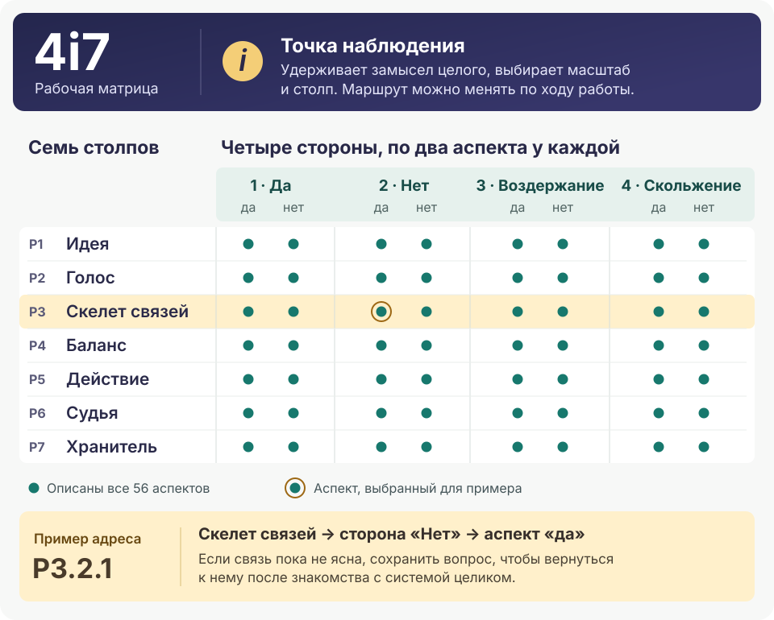

# 4i7

4i7 — философская основа для создания синергических систем. Она помогает видеть целое через связи между его частями, менять точку зрения и возвращаться к замыслу с новым пониманием.

**[Открыть карту системы](docs/project-map.md)** · [Полная матрица](https://github.com/i4w7w4a/4i7_psys/blob/7321ef1609d852861b3b1b52efccd083b234fa9f/docs/09-matrix.md) · [Словарь](https://github.com/i4w7w4a/4i7_psys/blob/5f106e8ba9057ed79aa65868d1aebf54890606d2/docs/glossary.md) · [Визуальный атлас](https://github.com/i4w7w4a/4i7_psys/blob/05d0064cafc2b75da054d9c94fd41d7e1168ff71/docs/research/visual-atlas-20261113/README.md)

Например, когда в целом пока не видна одна связь, в матрице есть место для самого вопроса. Адрес `P3.2.1` указывает на Скелет связей, его вторую сторону и первый аспект. Здесь можно отметить пробел и вернуться к нему, когда станут понятны соседние части. [Авторское уточнение](https://github.com/i4w7w4a/4i7_psys/issues/12#issuecomment-6878642283)

На карте приведена **рабочая матрица на 19 ноября 2026 года**. Там собраны семь столпов, открытые места и ссылки на происхождение формулировок. Первоначальный текст 4i7 и ранняя нумерация сохранены в истории основы. [Исходное описание](docs/origins.md) · [Каталог в GitHub Projects для участников](https://github.com/users/i4w7w4a/projects/4/views/1)
