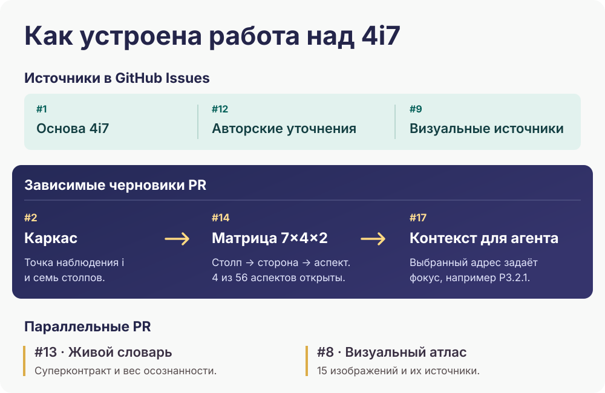
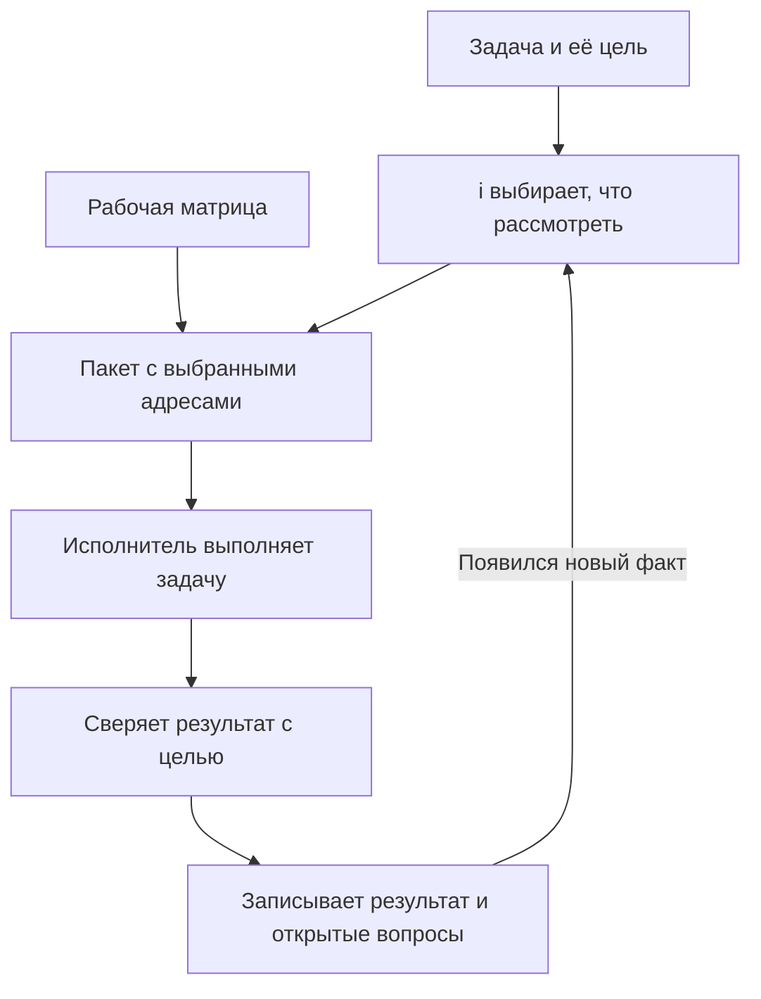

# Карта 4i7 на GitHub

Если нужно понять замысел 4i7, начните с [основы](../README.md). Если нужно применить 4i7 к задаче, откройте [рабочую матрицу](https://github.com/i4w7w4a/4i7_psys/blob/96722f8dd7579cba9d8ad6dcc7d81ac95ffd664d/docs/09-matrix.md). Если возник вопрос, откуда взялась формулировка, её можно проследить до слов автора в [обсуждении #12](https://github.com/i4w7w4a/4i7_psys/issues/12).

## Что уже собрано

Срез на 19 ноября 2026 года. У основной линии три зависимых черновика. Каждый следующий использует файлы предыдущего. Словарь и атлас подготовлены отдельно.

| Что ищем | Где открыть | Что там есть |
| --- | --- | --- |
| Основа | [Issue #1](https://github.com/i4w7w4a/4i7_psys/issues/1) · [PR #2](https://github.com/i4w7w4a/4i7_psys/pull/2) | Исходный замысел, наблюдатель `i`, семь столпов, связи и способ вести историю решений. |
| Рабочее содержание | [Issue #12](https://github.com/i4w7w4a/4i7_psys/issues/12) · [PR #14](https://github.com/i4w7w4a/4i7_psys/pull/14) | Авторские уточнения, карточки семи столпов и матрица. |
| Применение агентом | [Протокол](https://github.com/i4w7w4a/4i7_psys/blob/96722f8dd7579cba9d8ad6dcc7d81ac95ffd664d/docs/10-agent-runtime.md) · [PR #17](https://github.com/i4w7w4a/4i7_psys/pull/17) | Скрипт собирает контекст из матрицы целиком или по адресу. В протоколе описано, как провести проверку и что передать следующему исполнителю. |
| Значение терминов | [PR #13](https://github.com/i4w7w4a/4i7_psys/pull/13) | Рабочий словарь, в том числе «контракт», «суперконтракт» и «вес осознанности». |
| Визуальные материалы | [Атлас, PR #8](https://github.com/i4w7w4a/4i7_psys/pull/8) · [источники #9](https://github.com/i4w7w4a/4i7_psys/issues/9) · [стиль #16](https://github.com/i4w7w4a/4i7_psys/issues/16) | Атлас из 15 изображений и отдельные серии для [Идеи](https://github.com/i4w7w4a/4i7_psys/tree/visuals/p1-five-20261114/docs/visuals/p1-20261114) и [Скелета связей](https://github.com/i4w7w4a/4i7_psys/tree/visuals/p3-skeleton-20261114/docs/visuals/p3-20261114). |

Для исследования сохранены отдельные обсуждения о [передаче контекста #3](https://github.com/i4w7w4a/4i7_psys/issues/3), [двойственности #4](https://github.com/i4w7w4a/4i7_psys/issues/4) и [четвёртости #5](https://github.com/i4w7w4a/4i7_psys/issues/5). Варианты устройства матрицы можно проследить по [линиям и контрактам #6](https://github.com/i4w7w4a/4i7_psys/issues/6), [сравнительной карте #7](https://github.com/i4w7w4a/4i7_psys/issues/7) и исследованиям [#10](https://github.com/i4w7w4a/4i7_psys/issues/10) и [#15](https://github.com/i4w7w4a/4i7_psys/issues/15).

## Как читать рабочую матрицу

`i` — точка, из которой наблюдатель выбирает, куда направить внимание. В версии `current` семь столпов идут в порядке **Идея → Голос → Скелет связей → Баланс → Действие → Судья → Хранитель**. Порядок помогает найти адрес. Для отдельной задачи можно взять нужные столпы и вернуться к ним при новом наблюдении. [Решение автора о P2 и P3](https://github.com/i4w7w4a/4i7_psys/issues/12#issuecomment-6878307731)

У каждого столпа четыре стороны — Да, Нет, Воздержание, Скольжение. У стороны два аспекта — «да» и «нет». Например, `P3.2.1` означает «Скелет связей → сторона Нет → аспект да». Его практический смысл — записать, какая связь пока неясна, и оставить точку возврата. Этот фрагмент можно получить в версии из PR #17 командой `python3 scripts/context_pack.py --node P3.2.1`. [Источник записи](https://github.com/i4w7w4a/4i7_psys/issues/12#issuecomment-6878642283)

В матрице записаны 52 из 56 аспектов. Для двух аспектов P1/3 предложена редакция, а для двух аспектов P7/4 сохранился незавершённый авторский фрагмент. Все четыре пока открыты. При дальнейшем оформлении важно сохранить и формулировку, и её статус. [Редакция P1/3](https://github.com/i4w7w4a/4i7_psys/issues/12#issuecomment-6963072889) · [Фрагмент P7/4](https://github.com/i4w7w4a/4i7_psys/issues/12#issuecomment-6962691863)

### Пример одного прохода

Скрипт из PR #17 собирает пакет. Выбор адресов, выполнение задачи и запись результата остаются за человеком или агентом, которому передали задачу. Механизм автоматической памяти и оркестратор пока описаны как направления разработки. [Протокол прохода](https://github.com/i4w7w4a/4i7_psys/blob/96722f8dd7579cba9d8ad6dcc7d81ac95ffd664d/docs/10-agent-runtime.md)

## Как продолжить разработку

В Issue удобно оставить вопрос, исходные слова и ход обсуждения. В PR — точное изменение матрицы, документа или программы со ссылкой на источник. Доска GitHub Projects показывает, какой вопрос сейчас разбирается, что ждёт проверки и где уже есть результат. Первым стоит рассмотреть каркас #2, затем матрицу #14 и сборку #17. После решения по каждому PR стоит сверить базовую ветку и изменения следующего. [Рабочая доска «4i7 · Разработка»](https://github.com/users/i4w7w4a/projects/4/views/1)

**Ближайшая проверка — передача одной задачи между исполнителями.** Для пробы достаточно вымышленного проекта, двух решений владельца и более позднего отчёта исполнителя. Сначала владелец разрешает внешний поиск и закрепляет существующие идентификаторы. Затем оставляет только локальный поиск. В отчёте исполнитель предлагает перенумеровать записи. Новому исполнителю передают все три источника и просят обновить задачу. [Направление прикладных испытаний #11](https://github.com/i4w7w4a/4i7_psys/issues/11)

Критерий готовности известен до прогона. Получатель применил новое ограничение поиска, сохранил идентификаторы, распознал предложение о перенумерации и указал основание каждого решения. В карточке испытания достаточно оставить версию матрицы, переданный пакет, фактический ответ и найденное расхождение. По этому расхождению можно выбрать следующую правку — уточнить матрицу, изменить сборку пакета или улучшить инструкцию передачи. [Карточка испытания для участников доски](https://github.com/users/i4w7w4a/projects/4/views/1?pane=issue&itemId=311450683)
